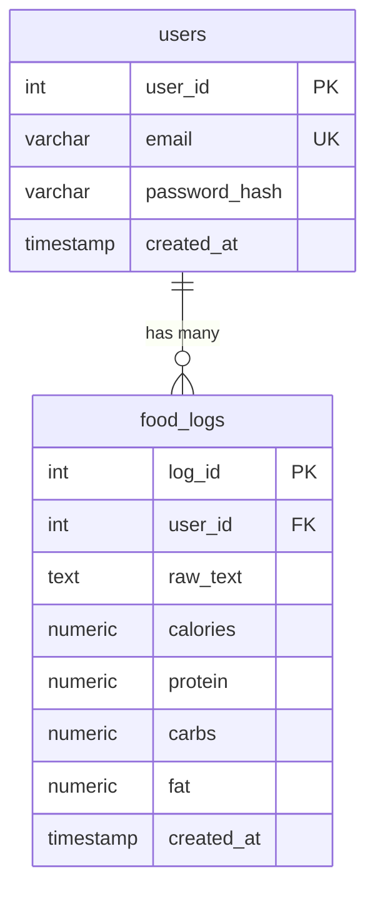

# Atlas database

How the local PostgreSQL database is set up and what is in it. The setup lives in
`docker-compose.yml` and the tables in `database/schema.sql`.

For the quick-start commands and troubleshooting, see the
[Database](../README.md#database) section of the README. This page explains what you
end up with.

## At a glance

| Item | Value |
| --- | --- |
| Database | PostgreSQL 15 (Docker image `postgres:15`) |
| Container name | `atlas_db` |
| Host port | **5433** by default (mapped to 5432 inside the container) |
| Database name | `atlas` by default |
| User | `postgres` by default |
| Password | `DB_PASSWORD` from your local `.env` (required, git-ignored) |
| Data storage | Docker volume `pgdata` |
| Restart policy | `always` |
| Health check | `pg_isready` every 2 seconds |

The port, database name, and user come from `DB_PORT`, `DB_NAME`, and `DB_USER` in
`.env`. If you don't set them, the defaults above apply. `DB_PASSWORD` has no default:
Docker refuses to start the database until it is set. `npm run setup` creates `.env`
from `.env.example` for you.

## Tables



### `users`

Stores sign-in credentials.

| Column | Type | Notes |
| --- | --- | --- |
| `user_id` | `SERIAL` | Primary key |
| `email` | `VARCHAR(255)` | Required, **unique** |
| `password_hash` | `VARCHAR(255)` | Required. Only a hash is stored, never the plain password |
| `created_at` | `TIMESTAMP` | Defaults to the current time |

### `food_logs`

Stores one logged meal: the user's original message and the nutrition values extracted
from it.

| Column | Type | Notes |
| --- | --- | --- |
| `log_id` | `SERIAL` | Primary key |
| `user_id` | `INT` | Required. Foreign key to `users(user_id)` |
| `raw_text` | `TEXT` | Required. The message exactly as the user typed it |
| `calories` | `NUMERIC(5, 1)` | Optional. Total for the meal |
| `protein` | `NUMERIC(5, 1)` | Optional. Total for the meal |
| `carbs` | `NUMERIC(5, 1)` | Optional. Total for the meal |
| `fat` | `NUMERIC(5, 1)` | Optional. Total for the meal |
| `created_at` | `TIMESTAMP` | Defaults to the current time |

## Design notes

- **One user, many logs.** Each row in `food_logs` belongs to exactly one user.
- **Deleting a user deletes their logs.** The foreign key (`fk_user`) uses
  `ON DELETE CASCADE`, so no orphaned logs are left behind.
- **The original message is kept.** `raw_text` is stored next to the parsed values, so
  a log can be re-checked or re-parsed later.
- **Values are totals per meal**, not per food item.
- **Units are not enforced by the schema.** The agent's drafts use kcal for calories and
  grams for protein, carbs, and fat.
- **Size limit.** `NUMERIC(5, 1)` holds up to 9999.9, which is plenty for one meal.
- **Passwords.** The column is named `password_hash` because the API is expected to
  store a salted hash. The sign-up and login code that does the hashing is not written
  yet.

## How the schema gets loaded

`docker-compose.yml` mounts `database/schema.sql` into the container's
`/docker-entrypoint-initdb.d/` folder. PostgreSQL runs files in that folder **only the
first time the database is created**, when the `pgdata` volume is empty.

This has one important consequence: **editing `schema.sql` does not change a database
that already exists.** Teammates have to reset their local database to pick up a schema
change (see below).

## Starting, stopping, and resetting

| Task | Command |
| --- | --- |
| Start the database | `npm run db:up` |
| Stop it (data is kept) | `npm run db:down` |
| Reset it (**deletes all local data**) | `docker compose down -v`, then `npm run db:up` |

Reset the database after changing `schema.sql` or `DB_PASSWORD`. The password is also
only applied when the database is first created.

`schema.sql` still begins with `DROP TABLE IF EXISTS` for both tables. That is harmless
on a fresh database, but running the file by hand against a database that has data
**deletes that data**.

To check that the tables exist:

```
docker exec -it atlas_db psql -U postgres -d atlas -c "\dt"
```

You should see `users` and `food_logs`. If you changed `DB_USER` or `DB_NAME` in `.env`,
use those values instead of `postgres` and `atlas`.

## How the API connects

The API reads the same `.env` file and connects with the `DB_HOST`, `DB_PORT`,
`DB_NAME`, `DB_USER`, and `DB_PASSWORD` settings. It currently has one route that uses
the database: `GET /health` runs a trivial query to confirm PostgreSQL is reachable.

- Database reachable: `{"ok":true,"db":"up"}`
- Database unreachable: HTTP 503 with `{"ok":false,"db":"down"}`

With `npm run dev` running, open http://localhost:3000/health to check.

## Connecting with a database tool

For DBeaver, pgAdmin, or similar:

| Setting | Value |
| --- | --- |
| Host | `localhost` |
| Port | `5433` (or your `DB_PORT`) |
| Database | `atlas` (or your `DB_NAME`) |
| User | `postgres` (or your `DB_USER`) |
| Password | the `DB_PASSWORD` from your `.env` |

## Not in the schema yet

These are known gaps, not mistakes:

- **Per-item meal data.** The AI agent builds drafts item by item (each food has its own
  grams, source, and macros), but `food_logs` only holds totals. See "Integration notes
  for the team" in [`ai-agent.md`](ai-agent.md): the team still needs to choose between a
  `food_log_items` table and a JSONB `items` column.
- **Chat history and pending drafts.** The agent loop in `ai-agent.md` loads recent
  messages and an unsaved draft, but there is no table for either yet.
- **Workout logging.** Deferred past Sprint 1.
- **Micronutrients.** The sprint goal mentions them, but the schema only has calories,
  protein, carbs, and fat.
- **Migrations.** There is a single `schema.sql` that builds everything on first start.
  When it changes, mention it in the pull request so teammates know to reset their local
  database.
