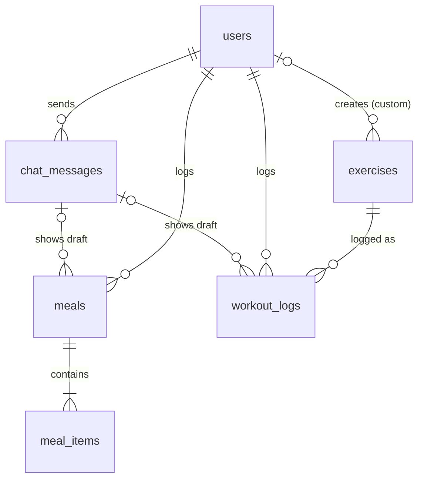

# Atlas database

How the local PostgreSQL database is set up and what is in it. The setup lives in
`docker-compose.yml` and the tables in numbered migration files in
`database/migrations/` (see [Migrations](#migrations)).

For the quick-start commands and troubleshooting, see the
[Database](../README.md#database) section of the README. This page explains what you
end up with.

## At a glance

| Item | Value |
| --- | --- |
| Database | PostgreSQL 15 (Docker image `postgres:15`) |
| Container name | `atlas_db` |
| Host port | **5433** by default (mapped to 5432 inside the container) |
| Database name | `atlas` by default |
| User | `postgres` by default |
| Password | `DB_PASSWORD` from your local `.env` (required, git-ignored) |
| Data storage | Docker volume `pgdata` |
| Restart policy | `always` |
| Health check | `pg_isready` every 2 seconds |

The port, database name, and user come from `DB_PORT`, `DB_NAME`, and `DB_USER` in
`.env`. If you don't set them, the defaults above apply. `DB_PASSWORD` has no default:
Docker refuses to start the database until it is set. `npm run setup` creates `.env`
from `.env.example` for you.

## Tables

Seven tables, designed from the app mockup (Today chat, Today's macros, Saved exercises)
and kept simple on purpose. Limits to handle later are in
[`database-known-issues.md`](database-known-issues.md). An eighth table,
`schema_migrations`, only records which migrations have run (see
[Migrations](#migrations)).



| Table | One row per | Used by (mockup) |
| --- | --- | --- |
| `users` | person | sign-in, time zone, lb/kg, daily goals (Today's macros) |
| `chat_messages` | chat message | the Today chat feed; history sent to the AI |
| `usda_foods` | USDA food | cache of per-100 g values from `search_foods` |
| `meals` | meal | meal cards, Today's macros meal list |
| `meal_items` | food in a meal | USDA / ESTIMATED badges, grams, per-item calories |
| `exercises` | exercise | Saved exercises list, Push / Pull / Legs filters, body diagram |
| `workout_logs` | exercise done once | workout cards ("3 × 8 · 185 lb"), "Last: …" |

### Fixed lists

These are Postgres enum types. The database rejects any other value, so typos like
`"Saved"` or `"tricep"` can't get in.

| Type | Values |
| --- | --- |
| `entry_status` | `draft`, `saved` |
| `meal_type` | `breakfast`, `lunch`, `dinner`, `snack` |
| `nutrient_source` | `usda`, `estimated` |
| `weight_unit` | `lb`, `kg` |
| `exercise_category` | `push`, `pull`, `legs`, `core`, `other` |
| `muscle` | `chest`, `front_delts`, `rear_delts`, `biceps`, `triceps`, `forearms`, `abs`, `upper_back`, `traps`, `lower_back`, `glutes`, `quads`, `hamstrings`, `calves` |

### `users`

Sign-in credentials, settings, and daily goals.

| Column | Type | Notes |
| --- | --- | --- |
| `user_id` | `SERIAL` | Primary key |
| `email` | `VARCHAR(255)` | Required, **unique** |
| `password_hash` | `VARCHAR(255)` | Required. Only a salted hash, never the plain password |
| `time_zone` | `VARCHAR(64)` | Default `America/Chicago`. Decides what "today" means for this user |
| `weight_unit` | `weight_unit` | Default `lb` |
| `goal_kcal`, `goal_protein_g`, `goal_carbs_g`, `goal_fat_g` | `INT` | Optional daily targets (e.g. 2400 / 160 / 260 / 80) |
| `created_at` | `TIMESTAMPTZ` | Defaults to now |

### `chat_messages`

The Today chat feed, so it survives an app restart. The API also sends the last 14 to
the AI as history.

| Column | Type | Notes |
| --- | --- | --- |
| `message_id` | `SERIAL` | Primary key |
| `user_id` | `INT` | Required. Foreign key to `users`; deleted with the user |
| `role` | `VARCHAR(5)` | `user` or `model` (Atlas) |
| `text` | `TEXT` | Required |
| `created_at` | `TIMESTAMPTZ` | Defaults to now. Drives the time labels in the feed |

A model message that showed a draft is linked from `meals.chat_message_id` or
`workout_logs.chat_message_id`. That is how the feed rebuilds each card, and whether it
shows Edit / Save (`draft`) or a Saved check (`saved`).

### `usda_foods`

Per-100 g values for every food `search_foods` returned. `draft_meal` reads them from
here, so a USDA item's numbers always come from USDA, never from the AI.

| Column | Type | Notes |
| --- | --- | --- |
| `fdc_id` | `INT` | Primary key. USDA FoodData Central ID |
| `description` | `TEXT` | USDA's name for the food |
| `kcal`, `protein_g`, `carbs_g`, `fat_g` | `NUMERIC` | Per 100 g |
| `fetched_at` | `TIMESTAMPTZ` | Last time USDA returned it |

### `meals`

One meal. Replaces the old `food_logs` table.

| Column | Type | Notes |
| --- | --- | --- |
| `meal_id` | `SERIAL` | Primary key |
| `user_id` | `INT` | Required. Foreign key to `users`; deleted with the user |
| `meal_type` | `meal_type` | Required. Drives "Lunch not logged yet" |
| `status` | `entry_status` | Default `draft`. **Only `saved` meals count toward totals** |
| `raw_text` | `TEXT` | Required. What the user typed or said |
| `chat_message_id` | `INT` | The Atlas message that showed this draft. Emptied if the message is deleted |
| `eaten_at` | `TIMESTAMPTZ` | When the meal was eaten. Defaults to now; the API sets it to the time of Save for now |
| `created_at` | `TIMESTAMPTZ` | Defaults to now |

### `meal_items`

The foods in a meal.

| Column | Type | Notes |
| --- | --- | --- |
| `item_id` | `SERIAL` | Primary key |
| `meal_id` | `INT` | Required. Foreign key to `meals`; deleted with the meal |
| `name` | `VARCHAR(200)` | Required, e.g. "Scrambled eggs" |
| `grams` | `NUMERIC(7, 1)` | Required, must be > 0 |
| `kcal_per_100g` | `NUMERIC(5, 1)` | Required, 0–900 |
| `protein_per_100g`, `carbs_per_100g`, `fat_per_100g` | `NUMERIC(4, 1)` | Required, 0–100 each |
| `kcal`, `protein_g`, `carbs_g`, `fat_g` | `NUMERIC` | **Calculated by the database** from grams × per-100 g. Read-only |
| `source` | `nutrient_source` | Required. `usda` or `estimated` |
| `fdc_id` | `INT` | USDA food ID. **Required when `source` is `usda`** |
| `estimate_basis` | `VARCHAR(200)` | Why the estimate, e.g. "typical homemade recipe". **Required when `source` is `estimated`** |

### `exercises`

Built-in exercises (no `user_id`) and each user's own.

| Column | Type | Notes |
| --- | --- | --- |
| `exercise_id` | `SERIAL` | Primary key |
| `user_id` | `INT` | Empty = built-in; set = that user's custom exercise (deleted with the user) |
| `name` | `VARCHAR(100)` | Required. **Unique per user, ignoring case** |
| `category` | `exercise_category` | Default `other`. The Push / Pull / Legs filters |
| `primary_muscle` | `muscle` | Main muscle worked. Optional until known |
| `secondary_muscles` | `muscle[]` | Helper muscles, e.g. `{triceps, front_delts}`. Default empty |
| `created_at` | `TIMESTAMPTZ` | Defaults to now |

`001_initial_schema.sql` adds built-in exercises with their muscles: the five from the
mockup (Bench Press, Overhead Press, Back Squat, Romanian Deadlift, Pull-up) plus common
lifts (Incline Bench Press, Dip, Push-up, Barbell Row, Lat Pulldown, Deadlift, Bicep Curl,
Leg Press, Lunge, Plank), so the AI matches them instead of creating duplicates (known
issue 5).

It also adds a **demo user** (`demo@atlas.local`, goals 2,400 kcal / 160 g protein /
260 g carbs / 80 g fat). There is no sign-in yet, so the API acts as this user.

### `workout_logs`

One exercise done once, e.g. "3 × 8 at 185 lb". When a session's sets differ (8, 8, 6
reps), the API stores one row per run of identical sets (2 × 8 and 1 × 6), all with the
same `chat_message_id`.

| Column | Type | Notes |
| --- | --- | --- |
| `log_id` | `SERIAL` | Primary key |
| `user_id` | `INT` | Required. Foreign key to `users`; deleted with the user |
| `exercise_id` | `INT` | Required. Foreign key to `exercises`. **An exercise with logs can't be deleted** |
| `sets`, `reps` | `INT` | Required, at least 1 |
| `weight` | `NUMERIC(6, 1)` | Empty = bodyweight (e.g. pull-ups). Otherwise ≥ 0 |
| `unit` | `weight_unit` | Default `lb` |
| `status` | `entry_status` | Default `draft`. **Only `saved` logs count toward history and the body diagram** |
| `raw_text` | `TEXT` | Required. What the user typed or said |
| `chat_message_id` | `INT` | The Atlas message that showed this draft. Emptied if the message is deleted |
| `performed_at` | `TIMESTAMPTZ` | When the exercise was done. Defaults to now; the API sets it to the time of Save for now |
| `created_at` | `TIMESTAMPTZ` | Defaults to now |

## Design notes

- **Drafts and saved entries share a table.** The AI creates rows with
  `status = 'draft'`; tapping Save changes them to `saved`. Every total, history, or
  chart query must filter on `status = 'saved'`.
- **Totals can't drift.** Meal item totals are generated columns: editing `grams`
  automatically recalculates `kcal`, `protein_g`, `carbs_g`, and `fat_g`. Meal and daily
  totals are sums of the items, not stored.
- **Where the numbers came from is enforced.** A `usda` item must have an `fdc_id`; an
  `estimated` item must have an `estimate_basis`.
- **Times are stored with their time zone** (`TIMESTAMPTZ`). Group by day using the
  user's `time_zone`, so an 11:30 PM snack doesn't land on the next day.
- **Body diagram** (planned; not in the app yet). Muscle progress will be calculated
  from saved `workout_logs`: each set counts 1 for the exercise's `primary_muscle` and
  ½ for each of its `secondary_muscles` (e.g. 3 sets of bench = chest 3, triceps 1.5,
  front delts 1.5). Nothing extra is stored.
- **Units.** Calories are kcal; protein, carbs, and fat are grams; workout weight is in
  the row's `unit`.
- **Passwords.** The API stores only a salted hash in `password_hash`. The sign-up and
  login code that does the hashing is not written yet.

## Migrations

The schema is built by small numbered SQL files in `database/migrations/`, applied in
order by a runner (`api/src/migrations.ts`). Each file runs **once** per database, so
a schema change never wipes your data: when you pull a teammate's new migration, only
that file runs.

```
database/migrations/
├── 001_initial_schema.sql      all tables, types, built-in exercises, demo user
└── 002_...sql                  each later change, one file each
```

| Command | What it does |
| --- | --- |
| `npm run db:migrate` | Applies every migration this database doesn't have yet |
| `npm run db:new-migration -- <name>` | Creates the next numbered file, e.g. `002_add_exercise_archive.sql` |

You rarely run `db:migrate` yourself: `npm run setup`, `npm run dev`, and
`npm run db:reset` run it first. (`npm run dev:api` doesn't; the API then warns, see
below.)

### How it works

- The runner records each applied file in the `schema_migrations` table (file name,
  checksum of its contents, time applied).
- Each file runs in its own **transaction**, together with its `schema_migrations` row.
  If any statement fails, nothing from that file is applied, the files after it don't
  run, and the error names the file (and the line, when PostgreSQL reports one).
- Only one runner works on a database at a time (a PostgreSQL advisory lock), so
  `npm run setup` and `npm run dev` can overlap safely.
- The runner never drops or resets anything on its own. Only the SQL in a migration
  changes the database.
- **Databases built by the old `schema.sql`** (before migrations) already match
  `001_initial_schema.sql`, so the runner records 001 as applied without running it
  and keeps your data. A database from an even older `schema.sql` (one missing some of
  the 7 tables) can't be upgraded; the runner says to run `npm run db:reset`.

### Writing a migration

1. `npm run db:new-migration -- add_exercise_archive` creates
   `database/migrations/002_add_exercise_archive.sql` with a header comment.
2. Write the SQL below the header, e.g.
   `ALTER TABLE exercises ADD COLUMN is_archived BOOLEAN NOT NULL DEFAULT false;`.
   Don't add `BEGIN`/`COMMIT`; the runner wraps the file in a transaction.
3. `npm run db:migrate` to apply it, then commit the file with the code that uses it.
   CI applies every migration to an empty database on each pull request.
4. Update the table docs on this page.

Rules:

- **Never edit or delete a migration once it is merged.** Other databases have already
  run it, and the runner stops with "changed after it was applied" if a file's contents
  differ from what it ran. To change something, add a new migration.
- **Your own unmerged migration** can still be edited: after changing it, run
  `npm run db:reset` to rebuild your database with the new version (deletes local data).
- **Keep data.** Prefer additive changes: new tables, new columns with a default or
  `NULL`, new indexes. To rename or remove something people's data depends on, copy the
  data over first (e.g. add the new column, `UPDATE` it from the old one, then drop the
  old column) in the same migration.
- **Two branches picked the same number?** The runner refuses to run (`share the number
  003`). Renumber the one that isn't merged yet.
- **Switched branches?** If your database has a migration from another branch, the runner
  prints a note and carries on.

## Starting, stopping, and resetting

| Task | Command |
| --- | --- |
| Start the database | `npm run db:up` |
| Stop it (data is kept) | `npm run db:down` |
| Apply new migrations (data is kept) | `npm run db:migrate` |
| Reset it (**deletes all local data**) | `npm run db:reset` |

`npm run db:reset` runs `docker compose down -v` (deletes the `pgdata` volume), starts
the database again, and applies every migration to the empty database. You only need it
after changing `DB_PASSWORD` (the password is only applied when the database is first
created), after editing your own unmerged migration, or for a database the runner can't
upgrade.

To check that the tables exist:

```
docker exec -it atlas_db psql -U postgres -d atlas -c "\dt"
```

You should see `chat_messages`, `exercises`, `meal_items`, `meals`, `schema_migrations`,
`usda_foods`, `users`, and `workout_logs`. If you changed `DB_USER` or `DB_NAME` in
`.env`, use those values instead of `postgres` and `atlas`.

## How the API connects

The API reads the same `.env` file and connects with the `DB_HOST`, `DB_PORT`,
`DB_NAME`, `DB_USER`, and `DB_PASSWORD` settings, through one shared pool
(`api/src/db.ts`). Which code uses which tables:

| Code | Tables |
| --- | --- |
| `api/src/user.ts` | `users` (finds the demo user; units, time zone, goals) |
| `api/src/chat.ts` | `chat_messages` (feed and AI history) |
| `api/src/drafts.ts` | `meals`, `meal_items`, `workout_logs`, `exercises` (stores drafts, saves them) |
| `api/src/summary.ts` | saved `meals` + `meal_items` (Macros), saved `workout_logs` + `exercises` (Exercises) |
| `api/src/progress.ts` | saved `meals` + `meal_items` (daily totals), saved `workout_logs` + `exercises` (top weights), `users` (goals, unit) |
| `api/src/agent/usda.ts` | `usda_foods` (USDA cache) |
| `api/src/agent/runTool.ts` | `exercises` (`find_exercise`), saved meals and workouts (summary and progress tools) |

`GET /health` checks that PostgreSQL is reachable and has every migration applied:

- Database reachable and up to date: `{"ok":true,"db":"up"}`
- Database unreachable: HTTP 503 with `{"ok":false,"db":"down"}`
- Migrations not applied yet: HTTP 503 with
  `{"ok":false,"db":"outdated","pending":["002_....sql"],"fix":"..."}`. Run
  `npm run db:migrate`. The API also logs "Database is missing migrations: ..." when it
  starts.
- A problem with the migration files themselves (a misnamed file, a reused number):
  HTTP 500 with `{"ok":false,"db":"error","error":"..."}`.

With `npm run dev` running, open http://localhost:3000/health to check.

## Connecting with a database tool

For DBeaver, pgAdmin, or similar:

| Setting | Value |
| --- | --- |
| Host | `localhost` |
| Port | `5433` (or your `DB_PORT`) |
| Database | `atlas` (or your `DB_NAME`) |
| User | `postgres` (or your `DB_USER`) |
| Password | the `DB_PASSWORD` from your `.env` |

## Not in the schema yet

These are known gaps, not mistakes. The full list, with what to add for each, is in
[`database-known-issues.md`](database-known-issues.md).

- **Per-set details** such as RPE or rest times. Uneven sets already work: "3 × 8, last
  set 6" is stored as a 2 × 8 row and a 1 × 6 row (see [`workout_logs`](#workout_logs)).
- **Goal history and workout sessions.** Left out until a feature needs them. (A
  workout draft's rows share a `chat_message_id`, which is enough for "Last: …" for now.)
- **Micronutrients.** The sprint goal mentions them, but the schema only has calories,
  protein, carbs, and fat.
- **Down migrations.** Migrations only go forward. To undo one, write a new migration
  that reverses it.
