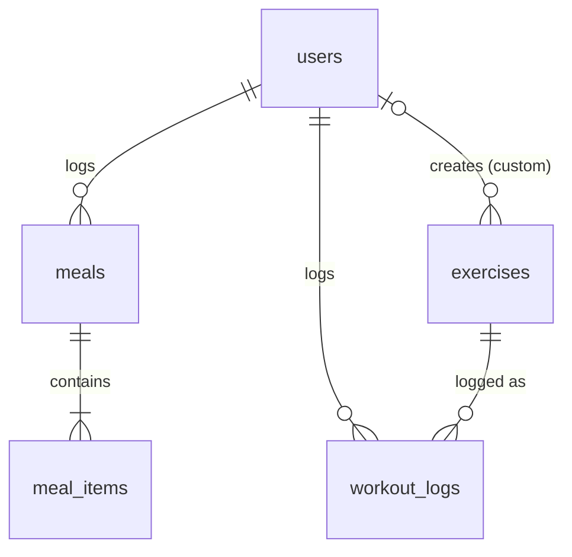

# Atlas database

How the local PostgreSQL database is set up and what is in it. The setup lives in
`docker-compose.yml` and the tables in `database/schema.sql`.

For the quick-start commands and troubleshooting, see the
[Database](../README.md#database) section of the README. This page explains what you
end up with.

## At a glance

| Item | Value |
| --- | --- |
| Database | PostgreSQL 15 (Docker image `postgres:15`) |
| Container name | `atlas_db` |
| Host port | **5433** by default (mapped to 5432 inside the container) |
| Database name | `atlas` by default |
| User | `postgres` by default |
| Password | `DB_PASSWORD` from your local `.env` (required, git-ignored) |
| Data storage | Docker volume `pgdata` |
| Restart policy | `always` |
| Health check | `pg_isready` every 2 seconds |

The port, database name, and user come from `DB_PORT`, `DB_NAME`, and `DB_USER` in
`.env`. If you don't set them, the defaults above apply. `DB_PASSWORD` has no default:
Docker refuses to start the database until it is set. `npm run setup` creates `.env`
from `.env.example` for you.

## Tables

Five tables, designed from the app mockup (Today chat, Today's macros, Saved exercises)
and kept simple on purpose. Limits to handle later are in
[`database-known-issues.md`](database-known-issues.md).



| Table | One row per | Used by (mockup) |
| --- | --- | --- |
| `users` | person | sign-in, time zone, lb/kg, daily goals (Today's macros) |
| `meals` | meal | meal cards, Today's macros meal list |
| `meal_items` | food in a meal | USDA / ESTIMATED badges, grams, per-item calories |
| `exercises` | exercise | Saved exercises list, Push / Pull / Legs filters, body diagram |
| `workout_logs` | exercise done once | workout cards ("3 × 8 · 185 lb"), "Last: …" |

### Fixed lists

These are Postgres enum types. The database rejects any other value, so typos like
`"Saved"` or `"tricep"` can't get in.

| Type | Values |
| --- | --- |
| `entry_status` | `draft`, `saved` |
| `meal_type` | `breakfast`, `lunch`, `dinner`, `snack` |
| `nutrient_source` | `usda`, `estimated` |
| `weight_unit` | `lb`, `kg` |
| `exercise_category` | `push`, `pull`, `legs`, `core`, `other` |
| `muscle` | `chest`, `front_delts`, `rear_delts`, `biceps`, `triceps`, `forearms`, `abs`, `upper_back`, `traps`, `lower_back`, `glutes`, `quads`, `hamstrings`, `calves` |

### `users`

Sign-in credentials, settings, and daily goals.

| Column | Type | Notes |
| --- | --- | --- |
| `user_id` | `SERIAL` | Primary key |
| `email` | `VARCHAR(255)` | Required, **unique** |
| `password_hash` | `VARCHAR(255)` | Required. Only a salted hash, never the plain password |
| `time_zone` | `VARCHAR(64)` | Default `America/Chicago`. Decides what "today" means for this user |
| `weight_unit` | `weight_unit` | Default `lb` |
| `goal_kcal`, `goal_protein_g`, `goal_carbs_g`, `goal_fat_g` | `INT` | Optional daily targets (e.g. 2400 / 160 / 260 / 80) |
| `created_at` | `TIMESTAMPTZ` | Defaults to now |

### `meals`

One meal. Replaces the old `food_logs` table.

| Column | Type | Notes |
| --- | --- | --- |
| `meal_id` | `SERIAL` | Primary key |
| `user_id` | `INT` | Required. Foreign key to `users`; deleted with the user |
| `meal_type` | `meal_type` | Required. Drives "Lunch not logged yet" |
| `status` | `entry_status` | Default `draft`. **Only `saved` meals count toward totals** |
| `raw_text` | `TEXT` | Required. What the user typed or said |
| `eaten_at` | `TIMESTAMPTZ` | When the meal was eaten (not when it was saved). Defaults to now |
| `created_at` | `TIMESTAMPTZ` | Defaults to now |

### `meal_items`

The foods in a meal.

| Column | Type | Notes |
| --- | --- | --- |
| `item_id` | `SERIAL` | Primary key |
| `meal_id` | `INT` | Required. Foreign key to `meals`; deleted with the meal |
| `name` | `VARCHAR(200)` | Required, e.g. "Scrambled eggs" |
| `grams` | `NUMERIC(7, 1)` | Required, must be > 0 |
| `kcal_per_100g` | `NUMERIC(5, 1)` | Required, 0–900 |
| `protein_per_100g`, `carbs_per_100g`, `fat_per_100g` | `NUMERIC(4, 1)` | Required, 0–100 each |
| `kcal`, `protein_g`, `carbs_g`, `fat_g` | `NUMERIC` | **Calculated by the database** from grams × per-100 g. Read-only |
| `source` | `nutrient_source` | Required. `usda` or `estimated` |
| `fdc_id` | `INT` | USDA food ID. **Required when `source` is `usda`** |
| `estimate_basis` | `VARCHAR(200)` | Why the estimate, e.g. "typical homemade recipe". **Required when `source` is `estimated`** |

### `exercises`

Built-in exercises (no `user_id`) and each user's own.

| Column | Type | Notes |
| --- | --- | --- |
| `exercise_id` | `SERIAL` | Primary key |
| `user_id` | `INT` | Empty = built-in; set = that user's custom exercise (deleted with the user) |
| `name` | `VARCHAR(100)` | Required. **Unique per user, ignoring case** |
| `category` | `exercise_category` | Default `other`. The Push / Pull / Legs filters |
| `primary_muscle` | `muscle` | Main muscle worked. Optional until known |
| `secondary_muscles` | `muscle[]` | Helper muscles, e.g. `{triceps, front_delts}`. Default empty |
| `created_at` | `TIMESTAMPTZ` | Defaults to now |

`schema.sql` adds five built-in exercises from the mockup: Bench Press, Overhead Press,
Back Squat, Romanian Deadlift, and Pull-up, each with its muscles.

### `workout_logs`

One exercise done once, e.g. "3 × 8 at 185 lb".

| Column | Type | Notes |
| --- | --- | --- |
| `log_id` | `SERIAL` | Primary key |
| `user_id` | `INT` | Required. Foreign key to `users`; deleted with the user |
| `exercise_id` | `INT` | Required. Foreign key to `exercises`. **An exercise with logs can't be deleted** |
| `sets`, `reps` | `INT` | Required, at least 1 |
| `weight` | `NUMERIC(6, 1)` | Empty = bodyweight (e.g. pull-ups). Otherwise ≥ 0 |
| `unit` | `weight_unit` | Default `lb` |
| `status` | `entry_status` | Default `draft`. **Only `saved` logs count toward history and the body diagram** |
| `raw_text` | `TEXT` | Required. What the user typed or said |
| `performed_at` | `TIMESTAMPTZ` | When the exercise was done. Defaults to now |
| `created_at` | `TIMESTAMPTZ` | Defaults to now |

## Design notes

- **Drafts and saved entries share a table.** The AI creates rows with
  `status = 'draft'`; tapping Save changes them to `saved`. Every total, history, or
  chart query must filter on `status = 'saved'`.
- **Totals can't drift.** Meal item totals are generated columns: editing `grams`
  automatically recalculates `kcal`, `protein_g`, `carbs_g`, and `fat_g`. Meal and daily
  totals are sums of the items, not stored.
- **Where the numbers came from is enforced.** A `usda` item must have an `fdc_id`; an
  `estimated` item must have an `estimate_basis`.
- **Times are stored with their time zone** (`TIMESTAMPTZ`). Group by day using the
  user's `time_zone`, so an 11:30 PM snack doesn't land on the next day.
- **Body diagram.** Muscle progress is calculated from saved `workout_logs`: each set
  counts 1 for the exercise's `primary_muscle` and ½ for each of its
  `secondary_muscles` (e.g. 3 sets of bench = chest 3, triceps 1.5, front delts 1.5).
  Nothing extra is stored.
- **Units.** Calories are kcal; protein, carbs, and fat are grams; workout weight is in
  the row's `unit`.
- **Passwords.** The API stores only a salted hash in `password_hash`. The sign-up and
  login code that does the hashing is not written yet.

## How the schema gets loaded

`docker-compose.yml` mounts `database/schema.sql` into the container's
`/docker-entrypoint-initdb.d/` folder. PostgreSQL runs files in that folder **only the
first time the database is created**, when the `pgdata` volume is empty.

This has one important consequence: **editing `schema.sql` does not change a database
that already exists.** Teammates have to reset their local database to pick up a schema
change (see below).

## Starting, stopping, and resetting

| Task | Command |
| --- | --- |
| Start the database | `npm run db:up` |
| Stop it (data is kept) | `npm run db:down` |
| Reset it (**deletes all local data**) | `docker compose down -v`, then `npm run db:up` |

Reset the database after changing `schema.sql` or `DB_PASSWORD`. The password is also
only applied when the database is first created.

`schema.sql` begins by dropping every Atlas table and type (including the old
`food_logs`). That is harmless on a fresh database, but running the file by hand against
a database that has data **deletes that data**.

**If your local database was created before this schema,** it still has the old
`users` and `food_logs` tables. Reset it once (below) to get the new tables.

To check that the tables exist:

```
docker exec -it atlas_db psql -U postgres -d atlas -c "\dt"
```

You should see `exercises`, `meal_items`, `meals`, `users`, and `workout_logs`. If you
changed `DB_USER` or `DB_NAME` in `.env`, use those values instead of `postgres` and
`atlas`.

## How the API connects

The API reads the same `.env` file and connects with the `DB_HOST`, `DB_PORT`,
`DB_NAME`, `DB_USER`, and `DB_PASSWORD` settings. It currently has one route that uses
the database: `GET /health` runs a trivial query to confirm PostgreSQL is reachable.

- Database reachable: `{"ok":true,"db":"up"}`
- Database unreachable: HTTP 503 with `{"ok":false,"db":"down"}`

With `npm run dev` running, open http://localhost:3000/health to check.

## Connecting with a database tool

For DBeaver, pgAdmin, or similar:

| Setting | Value |
| --- | --- |
| Host | `localhost` |
| Port | `5433` (or your `DB_PORT`) |
| Database | `atlas` (or your `DB_NAME`) |
| User | `postgres` (or your `DB_USER`) |
| Password | the `DB_PASSWORD` from your `.env` |

## Not in the schema yet

These are known gaps, not mistakes. The full list, with what to add for each, is in
[`database-known-issues.md`](database-known-issues.md).

- **Chat history.** No table yet, so the chat starts empty after an app restart. Meal
  and workout cards can still be rebuilt from `meals` and `workout_logs`.
- **Per-set detail.** `workout_logs` has one row per exercise, so "3 × 8, last set 6"
  can't be recorded exactly.
- **Goal history, workout sessions, and a USDA cache.** Left out until a feature needs
  them.
- **Micronutrients.** The sprint goal mentions them, but the schema only has calories,
  protein, carbs, and fat.
- **Migrations.** There is a single `schema.sql` that builds everything on first start.
  When it changes, mention it in the pull request so teammates know to reset their local
  database. Once there is real data to keep, switch to numbered migration files.
